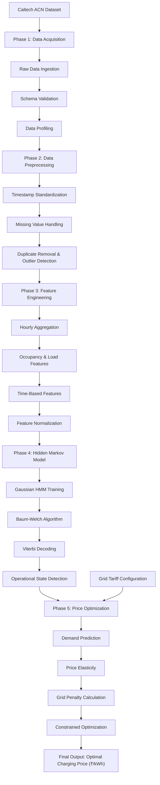

# Dynamic Price Optimization of EV Charging

## 1. Project Overview

| Project Detail | Description |
|---|---|
| **Project Name** | Dynamic Price Optimization of EV Charging |
| **Domain** | Artificial Intelligence, Machine Learning and Data Science |
| **Primary Dataset** | Caltech ACN-Data (Adaptive Charging Network) |
| **Programming Language** | Python |

### Objective

To develop a data-driven EV charging price optimization system that analyzes historical EV charging sessions, identifies charging demand patterns, detects different operational conditions using a Hidden Markov Model (HMM), and calculates an optimized charging price based on demand, electricity procurement costs, and grid constraints.

### Project Phases

1. Data Acquisition and Raw Ingestion
2. Data Cleaning and Preprocessing
3. Feature Engineering and Time-Series Construction
4. Hidden Markov Model Development
5. Dynamic Pricing and Optimization

---

## 2. High-Level System Architecture

The system follows a sequential data processing and optimization architecture.



---

## 3. Dataset Architecture

### 3.1 Primary Dataset: Caltech ACN-Data

The project uses the Caltech Adaptive Charging Network (ACN) dataset containing historical EV charging session information.

Important dataset attributes:

| Attribute | Description |
|---|---|
| `connectionTime` | Time when the vehicle connects |
| `disconnectionTime` | Time when the vehicle disconnects |
| `doneChargingTime` | Time when charging is completed |
| `kWhDelivered` | Total energy delivered |
| `sessionID` | Unique charging session identifier |
| `stationID` | Charging station identifier |
| `userID` | User identifier, when available |
| `userInputs` | Additional session information, when available |

### 3.2 Dataset Processing

The raw ACN dataset is converted into structured tabular data using Python and Pandas.

Processing operations:

- JSON extraction and parsing.
- Session-level data extraction.
- Timestamp conversion.
- Data quality validation.
- Missing-value analysis.
- Hourly aggregation.

### 3.3 External Configuration Data

The system uses an external configuration file for electricity procurement costs.

**Configuration file:** `config/grid_tariffs.json`

Proposed Time-of-Day tariff structure:

| Time Period | Time Range | Electricity Cost |
|---|---|---:|
| Off-Peak | 22:00–06:00 | ₹5.50/kWh |
| Normal | 06:00–17:00 | ₹7.00/kWh |
| Evening Peak | 17:00–22:00 | ₹10.50/kWh |


---

## 4. Phase-Wise System Architecture

### Phase 1 — Data Acquisition and Raw Ingestion

**Objective:** Collect and store raw EV charging session data for further processing.

**Input:**
- Caltech ACN JSON dataset.

**Main Operations:**

1. Dataset identification and extraction.
2. JSON data ingestion.
3. Session record extraction.
4. Schema validation.
5. Data type verification.
6. Raw data storage.

**Important Attributes:**

- `sessionID`
- `stationID`
- `connectionTime`
- `disconnectionTime`
- `doneChargingTime`
- `kWhDelivered`

**Expected Output:** Raw structured EV charging session data.

**Expected Storage:**

```text
data/
└── raw/
    └── Caltech_ACN/
        ├── acndata_sessions.json
        └── acndata_sessions (1).json
```

### Phase 2 — Data Cleaning and Preprocessing

**Objective:** Improve data quality and prepare reliable session records for feature engineering.

**Input:** Raw Caltech ACN session data.

**Main Operations:**

1. Timestamp standardization.
2. Timezone normalization.
3. Missing-value detection and handling.
4. Duplicate record identification.
5. Invalid timestamp correction.
6. Zero-energy session filtering.
7. Statistical outlier detection using IQR and Z-score.
8. Session duration calculation.

**Derived Variables and Formulas**

**1. Session Duration**

            Session Duration (minutes) =  Disconnect Time − Connection Time
                                          ----------------------------------
                                                          60

**2. Active Charging Duration**

            Active Charging Minutes = Done Charging Time − Connection Time
                                      ------------------------------------
                                                          60

**3. Idle Duration**

            Idle Duration (minutes) = Disconnect Time − Done Charging Time
                                      --------------------------------------
                                                          60
**4. Charging Rate**

              Charging Rate (kW) =   Energy Delivered (kWh) 
                                    -----------------------------
                                    Active Charging Time (hours)
                                    
**Expected Output:** Cleaned and validated EV charging session dataset.

### Phase 3 — Feature Engineering and Time-Series Construction

**Objective:** Transform individual EV charging sessions into a continuous hourly time-series dataset.

**Input:** Cleaned session dataset from Phase 2.

**Main Operations:**

1. Hourly resampling.
2. Aggregate charging load calculation.
3. Occupancy rate calculation.
4. Arrival rate calculation.
5. Transformer load ratio calculation.
6. Rolling statistical features.
7. Calendar feature extraction.
8. Cyclical time encoding.
9. Feature scaling.
10. Chronological train-validation-test splitting.

**Important Features**

| Feature | Purpose |
|---|---|
| Aggregate Power | Total charging power |
| Occupancy Rate | Charging port utilization |
| Arrival Rate | Number of new charging arrivals |
| Transformer Load Ratio | Transformer utilization |
| Hour of Day | Hourly demand pattern |
| Day of Week | Weekly demand pattern |
| Is Weekend | Weekend indicator |
| Rolling Mean | Demand trend |
| Rolling Standard Deviation | Demand variability |

**Important Formulas**

**1. Occupancy Rate**

                        Occupancy Rate = Occupied Charging Ports 
                                        --------------------------
                                          Total Charging Ports

**2. Transformer Load Ratio**
                        
                        TLR = Aggregate Active Power
                              ----------------------
                              Transformer Capacity


**3. Cyclical Time Encoding**
                        
                        Hour_sin = sin(2 × π × hour / 24)
                        
                        Hour_cos = cos(2 × π × hour / 24)

**Feature Matrix**

The observation matrix is represented as:
                    
                    O = [Aggregate Power, Occupancy Rate, Arrival Rate, Hour_sin, Hour_cos]

**Expected Output:** Hourly feature dataset ready for HMM development.

### Phase 4 — Hidden Markov Model Development

**Objective:** Identify hidden operational charging demand regimes using a Gaussian Hidden Markov Model.

**Input:** Normalized hourly feature matrix from Phase 3.

**Technologies:**

- `hmmlearn`
- `GaussianHMM`
- NumPy
- Scikit-learn

**Model Configuration**

```python
from hmmlearn.hmm import GaussianHMM

model = GaussianHMM(
    n_components=3,
    covariance_type="full",
    n_iter=200,
    random_state=42
)
```

**Three Hidden Operational States**

| Hidden State | Regime | Interpretation |
|---|---|---|
| S1 | Surplus | Low charging load |
| S2 | Baseline | Normal charging demand |
| S3 | Peak | High charging load and grid stress |

**Main Operations:**

1. Observation matrix construction.
2. Gaussian HMM initialization.
3. Baum-Welch model training.
4. Log-likelihood convergence monitoring.
5. Model selection using AIC and BIC.
6. Viterbi state decoding.
7. State transition probability analysis.
8. Operational regime interpretation.

**HMM Components:**

- Initial State Probability (π)
- Transition Probability Matrix (A)
- Emission Probability Distribution (B)

**Expected Outputs:**

- Trained Gaussian HMM model.
- Predicted operational states.
- State transition matrix.
- State probabilities and confidence information.

### Phase 5 — Dynamic Pricing and Optimization

**Objective:** Calculate the optimal EV charging price based on operational conditions, demand elasticity, electricity procurement cost, and grid safety constraints.

**Input:**

- Predicted HMM operational state.
- Hourly demand features.
- Electricity procurement cost.
- Base charging price.
- Grid capacity constraints.

**Main Operations:**

1. Regime-conditioned price elasticity.
2. Demand prediction.
3. Net margin calculation.
4. Grid overload penalty calculation.
5. Constrained price optimization.
6. Regulatory and ethical pricing safeguards.

**Regime-Based Price Elasticity**

| State | Operational Regime | Assumed Elasticity |
|---|---|---:|
| S1 | Surplus | -1.3 |
| S2 | Baseline | -0.8 |
| S3 | Peak | -0.3 |

> These elasticity coefficients are initial model assumptions unless estimated and validated using observed price-response data.

**Demand Function**

                      Q(P | S) = Q_base × (P / P_base)^ε

Where:

- Q = Predicted charging demand.
- P = Dynamic charging price.
- Q_base = Baseline demand.
- P_base = Baseline charging price.
- ε = Price elasticity for the operational state.

**Optimization Objective**

Maximize:

                      Profit = (P − C_wholesale) × Q(P | S) − Grid Overload Penalty

**Grid Overload Penalty**

If Load ≤ Safe Capacity:
                        
                        Penalty = 0

If Load > Safe Capacity:

                        Penalty = κ × (Load − Safe Capacity)^2

**Optimization Technology:**

- SciPy
- `scipy.optimize.minimize`
- SLSQP
- NumPy

**Pricing Constraints**

                        P_min = C_wholesale + δ
                        
                        P_min ≤ P_optimal ≤ P_max

A lifeline pricing safeguard is also included in the proposed design for vehicles with SOC below 15%, limiting the dynamic tariff to the base rate.

**Expected Final Output:**

- Optimal charging price (₹/kWh).
- Predicted demand.
- Expected net margin.
- Grid overload penalty.
- Recommended pricing regime.

---

## 5. Technology Stack

| Technology | Application |
|---|---|
| Python | Main programming language |
| Pandas | Data manipulation |
| NumPy | Numerical computation |
| SciPy | Statistical analysis and optimization |
| Scikit-learn | Feature scaling and preprocessing |
| hmmlearn | Gaussian Hidden Markov Model |
| Joblib | Model serialization |
| Matplotlib | Data visualization |
| Seaborn | Statistical visualization |
| JSON | Dataset and tariff configuration |

---

## 6. Proposed Project Directory Structure

The following is a logical project structure. Actual filenames and directories may differ depending on implementation.

```text
EV_charge/
│
├── data/
│   ├── raw/
│   │   └── Caltech_ACN/
│   │
│   └── processed/
│
├── config/
│   └── grid_tariffs.json
│
├── src/
│   ├── phase1_data_acquisition/
│   │
│   ├── phase2_data_cleaning/
│   │
│   ├── phase3_feature_engineering/
│   │
│   ├── phase4_hmm_model/
│   │
│   └── phase5_price_optimization/
│
├── models/
│
├── outputs/
│   ├── visualizations/
│   ├── predictions/
│   └── optimization_results/
│
├── requirements.txt
├── README.md
└── architecture.md
```

---

## 7. End-to-End Data Flow

The complete system follows this sequence:

1. Collect historical EV charging session records from Caltech ACN.
2. Extract session information from the raw JSON files.
3. Clean and preprocess the session records.
4. Generate hourly time-series features.
5. Normalize the feature matrix.
6. Train the Gaussian Hidden Markov Model.
7. Identify the operational charging regime.
8. Estimate demand based on the identified regime.
9. Apply the corresponding price elasticity.
10. Calculate the optimal charging price using constrained optimization.
11. Generate the final pricing recommendation.

---

## 8. Important Design Considerations

- Raw datasets should remain unchanged.
- Data cleaning should be reproducible.
- Missing and invalid values should be handled consistently.
- Train-test splitting should preserve chronological order.
- Feature scaling should avoid data leakage.
- HMM states should be interpreted using their observed feature characteristics.
- Electricity procurement tariffs should remain separate from the HMM observation vector.
- Price elasticity assumptions should be validated before practical use.
- Pricing should respect grid capacity and ethical pricing safeguards.

### Dataset Limitations

Caltech ACN session records provide charging-session information. They do not automatically provide every external variable required by the pricing engine.

Additional inputs such as the following must be separately configured, measured, or explicitly simulated:

- Local DISCOM electricity tariffs.
- Sanctioned transformer capacity.
- Observed consumer response to different prices.
- Vehicle battery State of Charge (SOC), where applicable.

---

## 9. Expected Final System Outcome

The final system aims to connect historical EV charging behavior with intelligent pricing decisions.

| Stage | Description |
|---|---|
| **Input** | Historical EV charging session data |
| **Processing** | Data cleaning and hourly feature engineering |
| **Modeling** | Hidden operational state detection using HMM |
| **Prediction** | Demand estimation based on operational regimes |
| **Optimization** | Dynamic price calculation with economic and grid constraints |
| **Output** | Optimized EV charging tariff in ₹/kWh |

